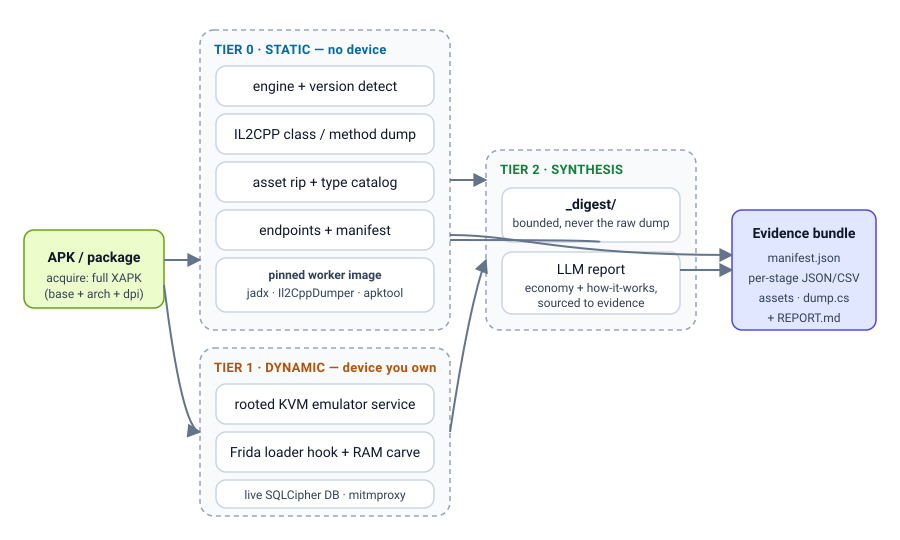

<div align="center">

# App-Cracker

### Reverse-engineer any Android app, end to end, with one pipeline.

**See a feature or an economy you want to understand. Pull it apart down to the bytecode, the live DB, and the runtime memory, with the evidence behind every claim.**


**[Quick start](#quick-start) · [How it works](#how-it-works) · [What you can analyze](#what-you-can-analyze) · [Showcases](#showcases) · [FAQ](#faq) · [Documentation](#documentation)**


</div>

---

See a mechanic in an app you want to understand, an economy you want to model, a config you suspect is server-tuned? App-Cracker takes an APK (or a package name) and produces a structured evidence bundle: the engine and its version, the asset catalog, the native class and method dump, the network endpoints, the live database, and the runtime Lua and config carved from memory on a device you control.

It is **engine-agnostic** and **package-parameterized**. The same pipeline runs on any APK; per-target keys and decoders live beside it. Static analysis needs no device. Dynamic analysis uses a rooted emulator or device you own. Every run writes a small digest so an LLM can synthesize a "how it works" report without reading gigabytes of dump.

> This is a private research workspace for competitive product analysis and security research. It analyzes apps; it does not produce or distribute modified apps.

## Quick start

Static pass, no device required:

```sh
# fetch the full split set (XAPK) so native libs are present, then run every static stage
python pipeline/crack.py acquire com.example.game --out out/com.example.game/_input
python pipeline/crack.py extract out/com.example.game/_input/base.apk --out out/com.example.game/latest
```

The deeper toolchain (jadx, Il2CppDumper, AXML decode) runs inside a pinned worker image so your host stays clean:

```sh
docker build -t app-cracker-worker:0.1.0 -f worker/Dockerfile .
docker run --rm -v "$PWD/in:/in:ro" -v "$PWD/out:/out" \
  app-cracker-worker:0.1.0 extract /in/app.apk --out /out
```

Operator-driven, through the Hermes agent in Discord: attach an APK (or give a package name), ask it to analyze the app, and it runs the pipeline to completion and returns a report plus the full bundle. See [`hermes-skill/app-cracker/SKILL.md`](hermes-skill/app-cracker/SKILL.md).

## How it works

App-Cracker is organized in three tiers. Each tier stands alone and writes into the same bundle, so you run only as deep as the question needs.

| Tier | Needs | What it recovers |
|---|---|---|
| **0 · Static** | Just the APK | Engine and version, asset catalog, IL2CPP class/method dump, string-literal pool, network endpoints, manifest and permissions |
| **1 · Dynamic** | A device or emulator you own | Runtime Lua and config carved from RAM, live SQLCipher DB pulled and decrypted, read/write and network monitoring |
| **2 · Synthesis** | Tier 0/1 output | An LLM reads a small `_digest/` (never the raw multi-GB dump) and writes a sourced economy and "how it works" report |

Two principles carry across every tier:

- **Evidence over assertion.** Outputs separate what was observed from what was inferred, and name what is still unknown. The synthesis tier is fed a bounded digest so its claims trace back to a source artifact, not to a guess.
- **Pin, do not float.** The worker toolchain is a single pinned image. No rolling tags, so a run today reproduces a run next month.

See the architecture map in [`docs/architecture.md`](docs/architecture.md).

<div align="center">

</div>

## What you can analyze

**Engines detected automatically:** Unity IL2CPP, Unity Mono, Flutter, React Native, and the Lua layer (tolua / XLua) that many games load at runtime.

| Surface | Tier | How |
|---|---|---|
| Assets: textures, sprites, meshes (OBJ), audio, fonts | 0 | UnityPy rip across every AssetBundle, with a type catalog |
| Native code: C# classes, methods, signatures | 0 | Il2CppDumper against `global-metadata.dat` |
| String-literal pool | 0 | Direct scan of the IL2CPP metadata |
| Network endpoints and hosts | 0 | DEX + JSON asset scan; live capture via mitmproxy in Tier 1 |
| Manifest, permissions, components | 0 | androguard decode |
| Live game state | 1 | SQLCipher DB pulled from the device and decrypted |
| Runtime logic and config | 1 | Frida hook on the Lua loader plus a RAM carve for bytecode and JSON |
| Behavior under play | 1 | File, SQLite, and network read/write monitoring |

The dynamic tier runs against a **rooted KVM emulator** that App-Cracker brings up as a container service, which is the reliable way to instrument titles whose anti-tamper defeats non-root instrumentation on a physical device. See [`services/android-emulator/README.md`](services/android-emulator/README.md).

## What a run produces

On a typical Unity/IL2CPP title with a Lua layer, a full pass recovers:

| Surface | Tier | Result |
|---|---|---|
| Engine and version | 0 | Engine family, Unity version, Lua runtime (tolua / XLua) detected |
| Native code | 0 | IL2CPP class and method dump with signatures |
| Assets | 0 | Textures, sprites, meshes (OBJ), audio, fonts, with a type catalog |
| Config | 0 | JSON / TextAsset config classified out of every AssetBundle |
| Endpoints | 0 | Hosts and URLs from DEX and assets; live capture in Tier 1 |
| Live state | 1 | App database pulled from the device and decrypted |
| Runtime logic | 1 | Lua and config carved from memory when it is loaded encrypted or signed at rest |

Two recurring findings drive the design:

- **Economy logic is often not in the APK.** Many titles load it as Lua at runtime, encrypted or signature-verified at rest, so static extraction alone is not enough. The dynamic tier hooks the loader and sweeps memory for it.
- **Non-standard Lua bytecode is common.** Hardened titles ship custom `luac` variants (altered header, instruction size) that stock decompilers reject, so the toolchain carries patched loaders.

> Per-target keys and decoders are kept out of this repository. The `pipeline/` core is package-parameterized; anything specific to one app lives in a private `targets/<package>/` alongside the operator's own captures.

## FAQ

**Is this specific to one game?** No. The `pipeline/` core is engine-agnostic and takes any APK. Per-target keys and decoders live in a private `targets/<package>/`, never in this repository.

**Do I need a rooted phone?** Not for Tier 0. Tier 1 needs a device or emulator you control; the bundled rooted KVM emulator service is the reliable path for hardened titles.

**Why a separate worker image?** So the host never has jadx, .NET, apktool, or frida installed, and so every run uses the same pinned toolchain. Reproducibility over convenience.

**Why carve Lua and config from RAM instead of from the APK?** Many titles load their economy logic as Lua at runtime, often encrypted or signed at rest. It is simply not in the static bundles, so the dynamic tier hooks the loader and sweeps memory.

**Can it modify or repackage the app?** It is for analysis. It can inject a Frida gadget into a resigned build for instrumentation on a device you own; it does not produce or distribute modified apps. See [`DISCLAIMER.md`](DISCLAIMER.md).

## Documentation

| Doc | Purpose |
|---|---|
| [`docs/architecture.md`](docs/architecture.md) | Component map and data flow across the three tiers |
| [`pipeline/README.md`](pipeline/README.md) | Tier 0 static extraction stages and entry point |
| [`worker/README.md`](worker/README.md) | The pinned RE toolchain and how it is driven per job |
| [`services/android-emulator/README.md`](services/android-emulator/README.md) | Rooted KVM emulator as a Tier-1 target |
| [`hermes-skill/app-cracker/SKILL.md`](hermes-skill/app-cracker/SKILL.md) | Operator-driven agent service contract |
| [`DISCLAIMER.md`](DISCLAIMER.md) | Intended use and limits |

### Repo layout

```
pipeline/            engine-agnostic static extraction (Tier 0) + dynamic stages (Tier 1)
worker/              pinned Docker toolchain driven per job
services/            containerized services (rooted KVM emulator = Tier-1 target)
hermes-skill/        the operator-driven app-cracker agent skill
docs/                architecture and assets
```
